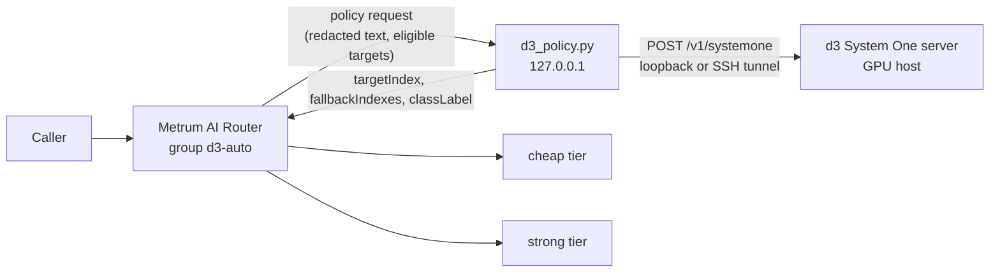

# Decision 3.0 (d3) External Policy

Metrum AI Router can use [vLLM Semantic Router](https://github.com/vllm-project/semantic-router)
Decision 3.0 ("d3") models as an advisory routing signal. A d3 model does not
generate text. It reads a state (here, the redacted request text) and a set of
typed questions, and returns a probability for every option. The Metrum AI
reference adapter, `examples/external-routing-policy/d3_policy.py`, turns those
answers into a target choice for a `strategy: external` model group.

The router keeps ownership of caller authorization, eligibility filtering,
fallback, usage records and decision telemetry. The adapter can only pick among
the eligible `targets` the router sends, as for any
[External Routing Policy Service](../configuration/external-routing-policy).



## When to use it

- You want a learned difficulty or task-type signal without training your own
  router, and you can run a small GPU model inside your trust boundary.
- You want to measure d3 recommendations in `shadow` against your current
  routing before changing what is served.

For outcome-trained routing on your own traffic, see
[Learned Routing Policy](./learned-routing-policy). For the full comparison,
see the [Routing Strategy Decision Tree](./strategy-decision-tree).

## How the adapter decides

For each request, the adapter:

1. Takes the router's redacted `text` field. It needs
   `external_policy.include_request: true`. The text is left-truncated to
   `text.max_chars` (default 32,768) so the most recent turns are kept.
2. Asks d3 the configured questions in one `POST /v1/systemone` call. The
   defaults are:
   - `difficulty` (`score`: trivial, moderate, hard, expert)
   - `reasoning` (`noul`: does this need multi-step reasoning?)
   - `kind` (`choice`: code, math, chat, agentic)
3. Applies the first matching rule. By default, `hard` or `expert` difficulty,
   or a reasoning probability of 0.6 or more, prefers `tier: strong`.
   Everything else prefers `tier: cheap`. The first eligible target that
   matches becomes `targetIndex`, and the other eligible targets follow in
   `fallbackIndexes`. If no eligible target matches a rule (for example the
   group has no `strong` tier), the next matching rule applies.
4. Returns a `classLabel` such as `d3:hard:code:r0.71`. Labels are built only
   from operator-configured option keys and a probability, never from request
   content, and are at most 64 characters.

Without request text (`include_request: false`, or an image-only request), the
adapter does not call d3. It applies `no_content_rules` to the scalar
`context` (by default `estimatedTokens >= 8000` prefers `strong`) and returns
`classLabel: d3:no-request-content`.

If d3 is unreachable, times out, returns non-JSON or malformed answers, rejects
the input (HTTP 422, for example over the model's context limit), or rejects
the bearer key, the adapter returns HTTP 502. The router then applies
`on_error`: `fail_closed` returns `routing-policy-error` without calling an
upstream, and `fallback` serves the normal target order. The adapter never
guesses a target.

Score answers use the most likely level for `in` conditions, with ties going to
the higher level, and the expected level index for numeric conditions. `noul`
answers compare the probability of "yes".

## Configure the adapter

The built-in defaults equal
`examples/external-routing-policy/d3_policy.example.yaml` (and the stdlib-only
`d3_policy.example.json`). Edit a copy to change questions or rules:

```yaml
d3:
  url: http://127.0.0.1:8000
  model: vllm-sr/d3-lite
  revision: a8d25a91ef75552803f7009d25b7bd435991abd9
  timeout_ms: 250          # includes waiting for a concurrency slot
  api_key_env: D3_API_KEY  # env var holding DECISION_API_KEY's value
  max_concurrency: 1       # d3_server.py serves one request at a time
text:
  max_chars: 32768
label: [difficulty, kind, reasoning]
rules:
  - name: strong-hard-or-reasoning
    when:
      any:
        - {question: difficulty, in: [hard, expert]}
        - {question: reasoning, gte: 0.6}
    prefer: [{tier: strong}]
  - name: cheap-default
    prefer: [{tier: cheap}]
no_content_rules:
  - name: strong-large-context
    when: {context: estimatedTokens, gte: 8000}
    prefer: [{tier: strong}]
  - name: cheap-default
    prefer: [{tier: cheap}]
```

Conditions can test a `question` (`in`, `not_in`, `eq`, `gte`, `lte`, `gt`,
`lt`) or a scalar policy-request `context` field, and can be combined with
`any`, `all` and `not`. Selectors in `prefer` match target `tier`, `provider`,
`model` or `modelRef`. The adapter validates the config at startup and exits if
a rule names an unknown question or option.

Run it next to the router:

```bash
D3_API_KEY=... python3 examples/external-routing-policy/d3_policy.py \
  --port 18094 --url http://127.0.0.1:8000 \
  --model vllm-sr/d3-lite --revision a8d25a91ef75552803f7009d25b7bd435991abd9
# YAML config: uv run --with pyyaml python examples/external-routing-policy/d3_policy.py --config my-d3.yaml
```

Command-line flags (`--url`, `--model`, `--revision`, `--timeout-ms`,
`--api-key-env`, `--max-concurrency`, `--max-chars`) override the config file.
`GET /health` reports the model, revision and counters. The adapter logs one
scalar JSON line per decision (outcome, rule, target index, label, d3
milliseconds, text length). It never logs request text.

## Configure the router group

The reference config includes a `d3-policy-demo` group; see
[External Routing Policy Service](../configuration/external-routing-policy#decision-30-d3-policy)
for the canonical snippet. A typical group:

```yaml
models:
  d3-auto:
    strategy: external
    external_policy:
      url: http://127.0.0.1:18094/route
      allow_hosts: [127.0.0.1]
      include_request: true
      timeout_ms: 300
      mode: shadow
      on_error: fail_closed
    targets:
      - { provider: fireworks, model_ref: deepseek-v4p1-flash, tier: cheap }
      - { provider: openai, model_ref: gpt-6-luna, tier: strong }
```

Tier names describe capability, not price. A cost saving needs a strong tier
that really costs more per token than the cheap one; in the pairing above,
`gpt-6-luna` has the lower list price. For a local instance,
`scripts/local_pi_instance.py --d3-policy-url ... --d3-strong-model gpt-6.1-sol`
selects a pricier strong tier and writes its list prices into the provider
catalog, so usage rows carry real costs. `--d3-cheap-model` does the same for
the cheap tier, and `--d3-tier-groups` adds single-target `d3-auto-cheap` and
`d3-auto-strong` groups for always-cheap and always-strong cost baselines
(issue #287).

Keep the router's `timeout_ms` above the adapter's d3 `timeout_ms`, and
validation caps it at 5,000 ms. Aim for 300 ms or less, because every policy
call, including in `shadow`, runs before the upstream call.

## Serve d3

Each d3 model package ships `d3_server.py`. On an NVIDIA GPU host:

```bash
python3.12 -m venv d3env && . d3env/bin/activate
pip install -r requirements.txt fastapi uvicorn   # from the pinned model revision
DECISION_API_KEY="$(openssl rand -hex 24)" \
  python d3_server.py --model vllm-sr/d3-lite \
    --revision a8d25a91ef75552803f7009d25b7bd435991abd9 \
    --device cuda:0 --host 127.0.0.1 --port 8000
```

Do not expose d3 publicly. Reach it from the router host over loopback or an
SSH tunnel, for example
`ssh -N -L 127.0.0.1:18300:127.0.0.1:8000 <gpu-host>`, and point the adapter
at `http://127.0.0.1:18300`. The router's `allow_hosts` then stays
`127.0.0.1`.

`d3_server.py` serves one request at a time. Keep `max_concurrency: 1` with it.
For concurrent traffic, use the batching `vllm-sr serve ... --engine` runtime
(same `/v1/systemone` API) or several workers, and raise `max_concurrency` to
match. Pin the model revision and check the package's `MODEL_MANIFEST.json`:
the family was first published on 2026-10-11.

## Privacy and trust boundary

- `include_request: true` sends request text to the adapter and on to d3. When
  the group has `pii_filter`, the text is redacted first. Without it, raw
  prompt text leaves the router.
- Run the adapter and d3 inside the same trust boundary as the router. Never
  send this traffic to a third party.
- The adapter's responses, labels and logs carry only scalar values. The
  router's policy telemetry stores the outcome, duration and `classLabel`, not
  the policy request.

## Tests

Credential-free checks, part of `make test`:

```bash
make d3-policy-test   # adapter unit tests against a scripted fake d3
make d3-policy-e2e    # router binary + adapter + fake d3 + mock upstreams
```

The e2e covers enforce (easy prompt to cheap, hard prompt to strong, also over
streaming), shadow (target 0 served, the d3 pick recorded as
`shadow_recommended_candidate`), d3 down with `fail_closed` (502
`routing-policy-error`, no upstream call) and with `fallback` (target 0), a d3
422, `include_request: false` (`d3:no-request-content`, d3 not called), and a
scan that finds no prompt text or credentials in the usage database or logs.
The fake d3 (`examples/external-routing-policy/fake_d3.py`) is a keyword
heuristic that matches the d3 wire format. It is wiring evidence, not model
quality evidence.

Live GPU measurements (d3 latency, shadow agreement, enforce tier split and
cost, coding-agent continuation and a failure drill) are recorded under
`docs/evidence/d3/` when they are run.

Copyright 2026 Metrum AI. Decision 3.0 and vLLM Semantic Router are projects of
their respective authors; Metrum AI Router integrates them through the public
external-policy contract.
